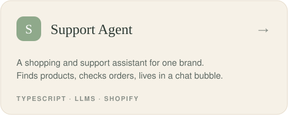

  
  
  
  
  

### ⚡ What I build, in one run

I take AI features from prototype to production: **multi-step LLM pipelines, shopping and support agents, and AI-search analytics** that show how ChatGPT, Gemini and Google AI Overviews talk about a brand. Day to day that's Next.js, TypeScript, Supabase/Postgres, background workflows and the Claude / GPT / Gemini APIs.

### 🚀 Featured work

  
  
  
  

<b>More projects</b>

 

| Project | What it is |
|---|---|
| [**VideoHub**](https://github.com/NikhilPatil15/VideoHub-Backend) | Video platform: auth, uploads and a streaming API, with a [TypeScript frontend](https://github.com/NikhilPatil15/Videohub-Frontend) |
| [**Blogify**](https://github.com/NikhilPatil15/Blogify) | Blogging platform on React + Redux with Appwrite auth and storage |
| [**music-ui**](https://github.com/NikhilPatil15/music-ui) · [live](https://music-ui-omega.vercel.app) | Music app UI built with Next.js and Aceternity UI |
| [**Portfolio**](https://github.com/NikhilPatil15/Portfolio) · [live](https://nikhil-patil-portfolio.vercel.app) | My portfolio site |

### 🛠️ Toolbox

   
  

### 📊 On GitHub

  
  
   
  

Built with hand-made animated SVGs · <a href="https://github.com/NikhilPatil15/NikhilPatil15/tree/main/assets">see how</a>

